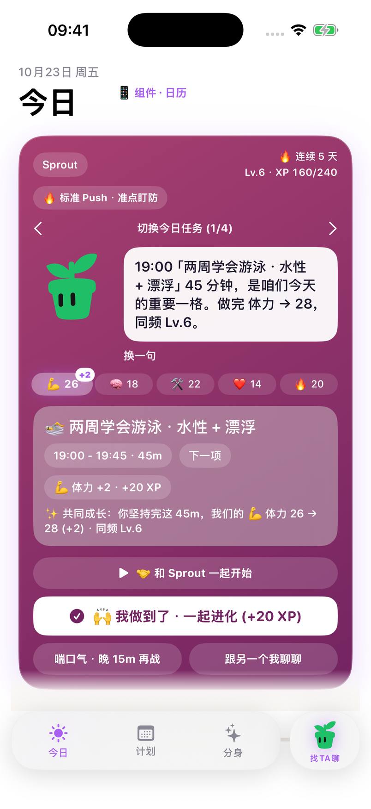
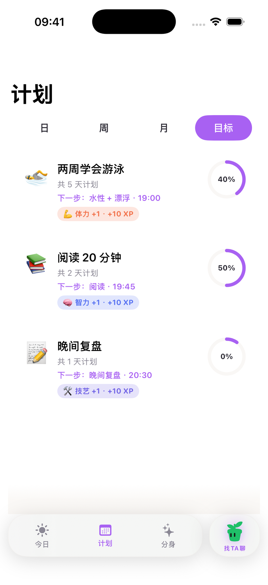
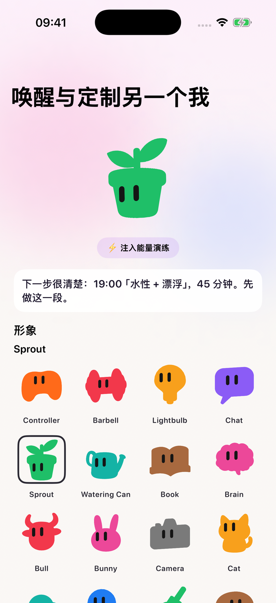
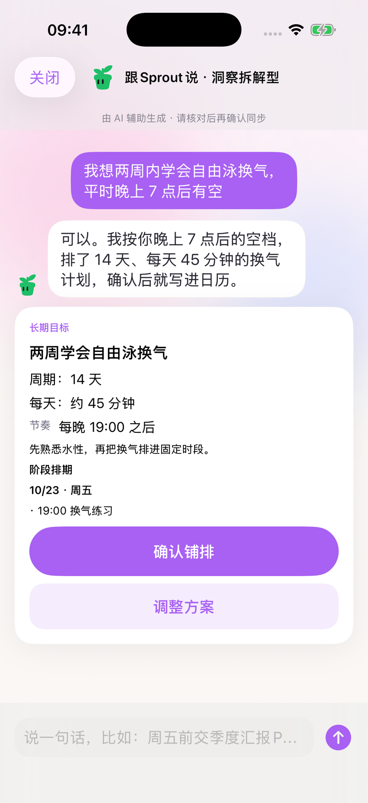

# PushMe

PushMe is a native iOS app. A companion — another you — helps turn a goal into a plan you review, then into one concrete next action.

This repository is the public website: product introduction, privacy, terms, and support. The iOS app lives in a separate project. The site is a **development preview**. It does not announce App Store availability and does not include a download link.

**Site:** https://henrywang0201.github.io/pushme/  
**中文:** https://henrywang0201.github.io/pushme/zh/

## What it does

1. You describe a goal in everyday language.
2. PushMe drafts a staged task plan with AI assistance.
3. You review it, adjust it, and confirm it. Nothing is scheduled until you confirm.
4. Today shows the next action, with a time and a duration. You can start it, mark it done, or postpone it by 15 minutes.
5. XP, level, a streak, and five growth dimensions record the progress you keep.

AI suggestions can be wrong. Read them before you confirm. You keep control of the plan and of what you do. PushMe does not promise a particular result.

## Features

- **Today.** The next concrete action, next to the companion. Start, complete, or postpone by 15 minutes. Level, XP, streak, and five growth dimensions are on the same screen.
- **Plan.** Day, week, month, and goals. The Goals screenshot below shows three demo goals with progress rings. It is not a populated calendar.
- **Companion.** Colorful official object avatars. Sprout, a green plant, is the current default.
- **Chat.** Discuss a goal and adjust the next steps. A proposed plan waits until you confirm it or ask for a change.

## Screenshots

Real iOS screens. The interface is Chinese. The goals are demo data.

The chat header in that screenshot still shows an older persona tag, 洞察拆解型. That tag is not how PushMe is positioned.

### Today

Sprout and the next action: a 19:00 swimming block in the demo, with start, complete, and a 15-minute postpone.

### Plan · Goals

Three demo goals with progress rings. Day, week, and month exist in the app. This picture is the Goals tab, not a filled-in calendar.

### Companion

Sprout selected among colorful official object avatars.

### Chat

A demo conversation about learning freestyle breathing, and a 14-day plan waiting for confirmation.

Full-size simulator PNGs are in [`assets/screenshots/full/`](assets/screenshots/full/). The images above are smaller copies for the web, still sharp enough to read.

## Pages

| Page | English | 简体中文 |
| --- | --- | --- |
| Introduction | [index.html](index.html) | [zh/index.html](zh/index.html) |
| Privacy | [privacy.html](privacy.html) | [zh/privacy.html](zh/privacy.html) |
| Terms | [terms.html](terms.html) | [zh/terms.html](zh/terms.html) |
| Support | [support.html](support.html) | [zh/support.html](zh/support.html) |

GitHub Pages serves this repository as static files (`.nojekyll` is present). Homepage layout is in `assets/css/home.css`. Shared header, footer, and legal-page styles stay in `assets/css/styles.css`.

## Contact

Yiheng Wang · [wangyiheng0201@163.com](mailto:wangyiheng0201@163.com)

## 简体中文

PushMe 是一款原生 iOS 应用。另一个我帮你把目标谈成一份计划，你查看、调整、确认之后，今天页只留下下一项具体行动。

本仓库是公开网站，不是 iOS 应用工程。网站目前是**开发预览**，不公布 App Store 上架状态，也没有下载链接。

- 用自然语言说目标。
- AI 辅助草拟分阶段任务计划。
- 你审阅、调整、确认。确认前不会写进日程。
- 今天页给出下一项的时间和时长。可以开始、完成，或推迟 15 分钟。
- 经验、等级、连续天数和五个成长维度记下进度。

请先看过 AI 的建议再确认。计划和要做的事仍由你决定。PushMe 不保证某个结果。

计划页有日、周、月、目标。下面的计划截图是「目标」，不是已排满的日历。同伴可以换成彩色的官方物件形象，当前默认是绿色小芽 Sprout。聊天截图标题栏里的「洞察拆解型」是旧人设标签，不代表产品定位。

界面为中文，内容是演示数据。
